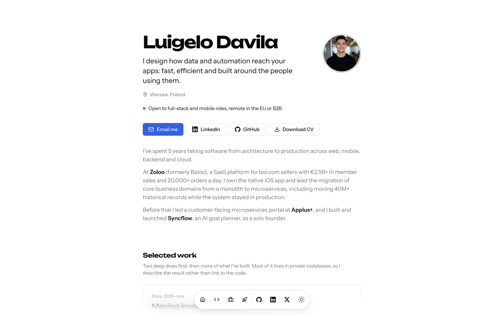

# luigelo.ldvloper.com

[](https://luigelo.ldvloper.com)

My portfolio, live at **[luigelo.ldvloper.com](https://luigelo.ldvloper.com)**. It holds two engineering case studies (a production migration of 40M+ records out of a monolith, and an AI agent that always asks before acting), my experience, testimonials, a GitHub contribution graph and a CV you can download.

Built with Next.js 16 (App Router), React 19 and TypeScript, styled with Tailwind CSS and Radix UI primitives, with MDX for the case studies and Motion for the animations. The contribution graph comes from the GitHub GraphQL API, fetched on the server and revalidated hourly. Hosted on Vercel, with Vercel Analytics and Speed Insights.

## Run it locally

Needs Node 24 (see `.nvmrc`).

```bash
npm ci
cp .env.example .env   # optional: a GitHub token for the contribution graph
npm run dev            # http://localhost:3000
```

`npm run lint` checks the code. `npm run cv:export` builds the site and prints `/cv` to `public/cv/` as a PDF with headless Chrome (set `CHROME_PATH` if Chrome is not in the default macOS location).

## How it's put together

Case studies are MDX files in `src/content/case-studies`, registered in a typed index that holds their metadata (company, period, stack, key facts) and a `draft` flag, so a study can be previewed in development and stays a 404 in production until it is ready. I chose MDX because the write-ups embed React diagrams next to the prose, which plain Markdown or a CMS would not allow. Everything else on the page (profile, experience, projects, testimonials) is JSON in `src/data`, so copy edits never touch a component. The CV is a page, `/cv`, that a GitHub Action prints to PDF and commits whenever its content changes, so the download never drifts from the site.

## License

The source code is released under the [MIT License](LICENSE). The content is not: the texts, case studies, images, CV and personal data are © Luigelo Davila and may not be copied or reused without permission.
